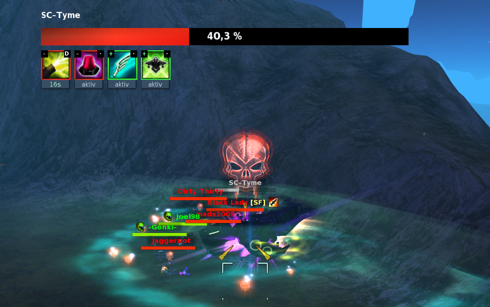
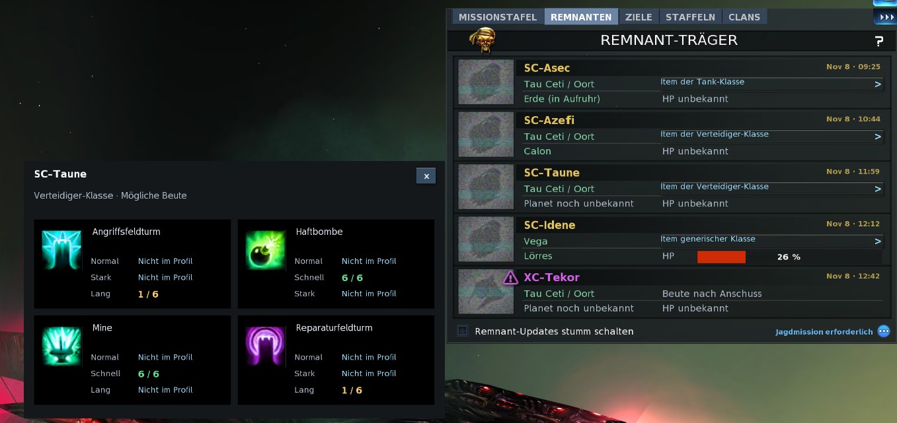
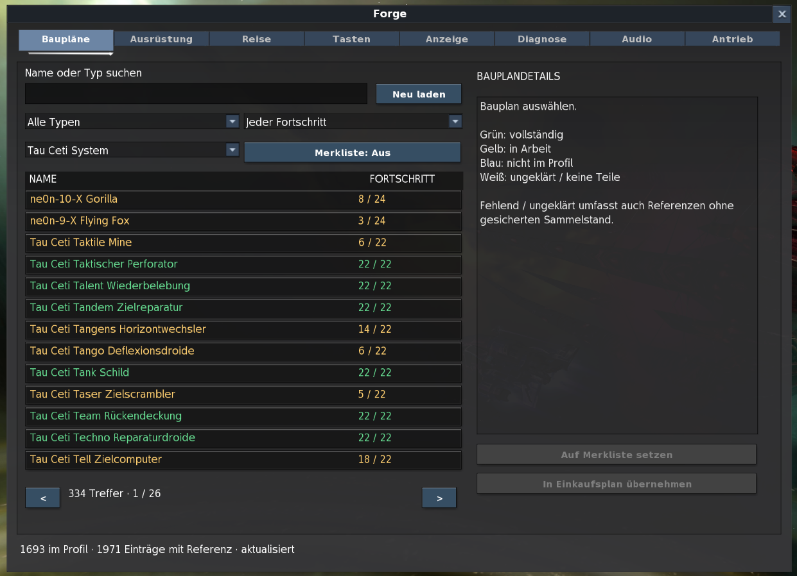

# Pirate Galaxy Forge

Inoffizieller **64-Bit-Communityclient für Pirate Galaxy** – mit zusätzlichen Spielanzeigen, anpassbarem HUD, eigenen Sounds und gezielten Performance- und Fehlerkorrekturen.

**[Windows-Installer herunterladen](https://github.com/FallenIncursio/pirate-galaxy-forge-releases/releases/download/v0.1.0-alpha.70/PirateGalaxyForge-0.1.0-alpha.70-Setup.exe)** · **[Linux-Vorschau herunterladen (Wine)](https://github.com/FallenIncursio/pirate-galaxy-forge-releases/releases/download/v0.1.0-alpha.70/PirateGalaxyForge-Linux-Wine-Preview-Alpha70.zip)** · **0.1.0-alpha.70** · [Releasehinweise und Prüfsummen](https://github.com/FallenIncursio/pirate-galaxy-forge-releases/releases/tag/v0.1.0-alpha.70)

[Alle Funktionen im Vergleich](docs/FUNKTIONEN.md) · [Bildergalerie](docs/BILDER.md) · [Installation und Hilfe](docs/HILFE.md)

Mit Alpha 54 startet Forge direkt in 64 Bit. Forge lädt die benötigten Spielbasisdateien beim ersten Start direkt von Splitscreen.

Alpha 55 ergänzt die Bossleiste für Ancient-Giza, Ancient-Soris und Ancient-Amarna in Sirius.
Alpha 58 ergänzt die Effekt-Tooltips um Empfänger, beobachtete Wirkzeit und bestätigte eigene Anwendungen.

Alpha 59 bringt die lokale Vorschau des Remnant-Kampfberichts mit Pilot- und Staffelansicht. [Aufnahme und Auswertung](docs/HILFE.md#remnant-kampfbericht-vorschau)

Alpha 60 korrigiert das reproduzierte Schattenflackern auf Hoch und Ultra sowie einen Absturz beim Skalieren des HUD.

Alpha 61 stabilisiert die Projektion der Bodenschatten bei ungewöhnlich großen Objektbegrenzungen.

Alpha 62 verbessert die Übergänge zwischen Oberfläche, Orbit und Sternkarte. Auf Erebos lädt Forge entfernte Dekoration nach der Landung schrittweise.

Alpha 63 erklärt alle Optionen unter **Forge → Anzeige** per Tooltip. Beim Kryonit-Sammeln wechselst du die Drohne über die manuelle Steuerung. Springt ein feindlicher Spieler per Quantensprung, greift die normale Zielabwahl des Spiels.

Alpha 64 korrigiert die Drohnenanzeige im Hangar. Nach einem Schiff- oder Konfigurationswechsel zeigt die Liste die aktuelle Belegung.

Alpha 65 korrigiert die Scan-Details bei schnellen Zielwechseln. Mit **E** oder dem Scan-Knopf öffnest du die Details zum aktuell ausgewählten Objekt.

Alpha 66 schützt offene Bestätigungen für Missionen, Staffeln und Clans vor konkurrierenden Aktionen. Nach **Abbrechen** erscheinen die Schaltflächen und Missionssymbole wieder korrekt.

Alpha 67 merkt sich **Autom. Pilot wählen** bei gespeicherten Logindaten. Ist der zuletzt gewählte Server gerade nicht erreichbar, öffnet Forge die Pilotenauswahl und behält deine Einstellung für den nächsten Login.

Alpha 69 ergänzt einen Auftritt mit Bossnamen, farbigem Lichtimpuls und abschaltbarer Musik für Remnant-Träger, die Mantis-Königin und die drei Sirius-Bosse. [Releasehinweise](https://github.com/FallenIncursio/pirate-galaxy-forge-releases/releases/tag/v0.1.0-alpha.69)

Alpha 70 behebt Java-27-, UI- und Ressourcenfehler sowie die Erkennung des Schneewaffeneffekts. Die Audio-Diagnose bleibt bei Weltwechseln lesbar. D3D9, vorhandene Einstellungen und gespeicherte Anmeldungen bleiben erhalten. [Releasehinweise](https://github.com/FallenIncursio/pirate-galaxy-forge-releases/releases/tag/v0.1.0-alpha.70)

## Ein Blick ins Spiel

**Bossleisten mit HP-Prozent und aktiven Effekten**

[](docs/BILDER.md#bossleiste)

**Mögliche Remnant-Beute direkt mit dem eigenen Bauplanbestand vergleichen**

[](docs/BILDER.md#remnant-beute)

**Baupläne durchsuchen, Fortschritt filtern und eine Merkliste führen**

[](docs/BILDER.md#bauplaene)

[Weitere Bilder: Audio, Antriebsvorschau, HUD-Größe und Komponenten-Timer →](docs/BILDER.md)

## Was ergänzt Forge gegenüber dem Original?

Die Spielwelt, Missionen, Gegenstände, Originalgrafiken und Grundfunktionen stammen aus **Pirate Galaxy**. Forge baut darauf auf.

| Bereich | Im Original bereits vorhanden | Zusätzlich in Forge |
| --- | --- | --- |
| Baupläne und Ausrüstung | Bauplanprofil, Shop und Komponentenwerte | Suche, Fortschritts-/Systemfilter, Referenzkatalog, Merkliste, Vergleich und Einkaufsplan |
| Remnant-Träger | Trägertabelle, Bekanntgaben, Statusbalken und Abflugtimer | HP-Prozent, verständliche Wartephase und Beutekarten mit eigenen Variantenbeständen |
| Staffel und Bosse | Staffel- und Zielanzeigen | Staffel-HP in Prozent, Effektsymbole und zusätzliche Bossleisten für Remnants und Königin |
| Komponenten und Ziele | Aktivierung, Abklingzeiten und Zielauswahl | Slots umordnen, Tasten belegen, Aktivzeit-Timer, Reichweitenmarkierungen und Zielhaltung nach Quantensprung außerhalb von PvP |
| Sammeln und Drohnen | Energiekugeln, Kryonit und manuelle Drohnensteuerung | Größte Energiekugel markieren, Kryonitstatistik und geschätzte Drohnen-Levelzeiten |
| Kampfansicht | Reparaturfelder, Orbitalwarnungen und HP-Warnsound | Gedämpfte Reparaturfelder, zusätzliche Orbitalanzeigen, einstellbare HP-Warnschwelle und rote Bildschirmränder |
| HUD und Chat | Spielfenster, Chat und Statusformatierung | Globale HUD-Skalierung, Chat-Uhrzeit, Status-Farbeditor und schaltbare Meldungen |
| Musik und Sounds | Originalmusik, Effekte und Lautstärkeregler | Eigene Ogg-Vorbis-/WAV-Dateien, Ausschnitte, Vorschau und Lautstärke pro Sound; ohne Client-Neustart übernehmen |
| Antriebsspuren | Tatsächlich ausgerüstete Spur | 27 Spuren und Schiffsstandard als lokale Live-Vorschau am eigenen Schiff |
| Reise und Sirius | Sternkarte und Planeteninformationen | Positionsmerker, berechnete Reichweitenfenster und Reiseerinnerungen |
| Leistung und Diagnose | Vorhandene Spiel-Engine und Pinganzeige | Einstellbares FPS-Limit und VSync, Bildzeiten, 1%-Lows und lokale Diagnoseaufnahmen |
| Discord | Externe Spiel-/Overlay-Erkennung | Integrierter Spielstatus als „Pirate Galaxy“ mit Logo, Sitzungsdauer und optionalem Ort |

**Neu, erweitert oder korrigiert?** Die [ausführliche Funktionsübersicht](docs/FUNKTIONEN.md) kennzeichnet die Herkunft jeder Ergänzung und erklärt ihre Grenzen. Beispielsweise sind farbige Statustexte und der HP-Warnsound Originalfunktionen; Farbeditor und einstellbare Warnschwelle kommen von Forge.

## Technik und Korrekturen

- **64-Bit-Laufzeit:** größerer nutzbarer Adressraum als im 32-Bit-Client.
- **Weniger Speicherarbeit:** Wiederverwendung kurzlebiger Render-/Kameraobjekte und weniger unnötige UI-Aktualisierungen.
- **Gezielte Fehlerkorrekturen:** unter anderem Textumbruch, Planeten-/Schiffsvorschauen, Commerce-Central-Gebäudetexturen, Audioverarbeitung und Komponentenstatus.
- **Eigener Updateweg:** getrennte Spielkopie, signierte Update-Metadaten und geprüfte Downloads.

64 Bit allein garantiert weder höhere FPS noch Absturzfreiheit. Forge bleibt eine **experimentelle Alpha**; unter anderem Schattenflackern und spät erscheinende Gegner sind nicht allgemein behoben. Es werden keine neuen 4K-Texturen mitgeliefert.

## Installation

Voraussetzungen sind **Windows 10/11 (64 Bit), .NET Framework 4.8 oder neuer und Internetzugang**. Forge unterstützt den Spielstand **1002132**.

1. Den Forge-Installer ausführen und **Pirate Galaxy Forge** starten.
2. Forge lädt und prüft die Spielbasis von Splitscreen und Java von Azul. Sobald das Spielfenster erscheint, im Spiel anmelden.

Bei vorhandenen Installationen übernimmt Forge die Einstellungen. Falls der alte Starter vor der Updateprüfung einen Originalordner verlangt oder das Update scheitert, Forge schließen und das aktuelle Setup über die vorhandene Installation ausführen.

Im Spiel öffnet **F in der oberen Menüleiste** das Forge-Fenster. Andere Fenster und Spielaktionen außerhalb bleiben bedienbar. Die Anzeigeoptionen sind in fünf Gruppen zusammengefasst. Halte den Mauszeiger kurz über eine Beschriftung oder ein Bedienelement, um den Tooltip zu öffnen.

### Linux-Vorschau (Wine)

Du brauchst **Linux x86_64, Python 3.9 oder neuer**, eine grafische Sitzung und Internetzugang. Wine muss 32- und 64-Bit-Windows-Programme unterstützen und `winepath` bereitstellen. Installiere auch die Wine-Schriften (unter Ubuntu `fonts-wine`).

Entpacke das ZIP der Linux-Vorschau und öffne im entpackten Ordner ein Terminal. Der erste Befehl richtet ein eigenes Wine-Profil für Forge ein. Der zweite startet den Client. [ZIP der Linux-Vorschau](https://github.com/FallenIncursio/pirate-galaxy-forge-releases/releases/download/v0.1.0-alpha.69/PirateGalaxyForge-Linux-Wine-Preview-Alpha69.zip)

```sh
python3 forge_wine.py install
python3 forge_wine.py launch
```

Danach kannst du Forge auch über den Menüeintrag **Pirate Galaxy Forge (Wine Preview)** starten.

Forge bezieht Spielupdates beim Start aus dem signierten Kanal. Für die aktualisierten Linux-Startdateien das neue ZIP entpacken und `python3 forge_wine.py install` erneut mit demselben Profilpfad ausführen. Wenn Wine den gespeicherten Kampfbericht nicht öffnet, `python3 forge_wine.py report` verwenden. Bei einem eigenen Profil für alle Befehle denselben `--root`-Pfad angeben.

## Hilfe und Projekt

- [Installation, Updates und Fehler melden](docs/HILFE.md)
- [Lokale Daten, freiwillige Aktivitätszählung und Fehlerberichte](docs/DATENSCHUTZ.md)
- [Alle Veröffentlichungen](https://github.com/FallenIncursio/pirate-galaxy-forge-releases/releases)

Bibliotheksquellen und Lizenzhinweise stehen beim jeweiligen Release als separate Archive bereit. Der Forge-Entwicklungscode ist privat. Die Screenshots zeigen Forge; sie sind keine Vergleichsaufnahmen des Originalclients.

Pirate Galaxy Forge ist kein offizielles Produkt von Splitscreen Studios.
