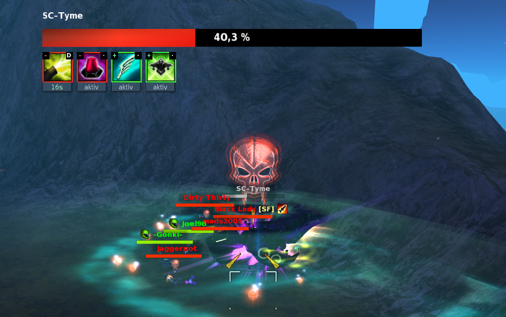
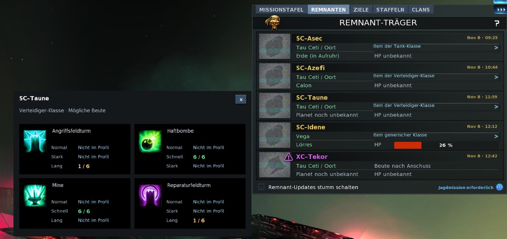
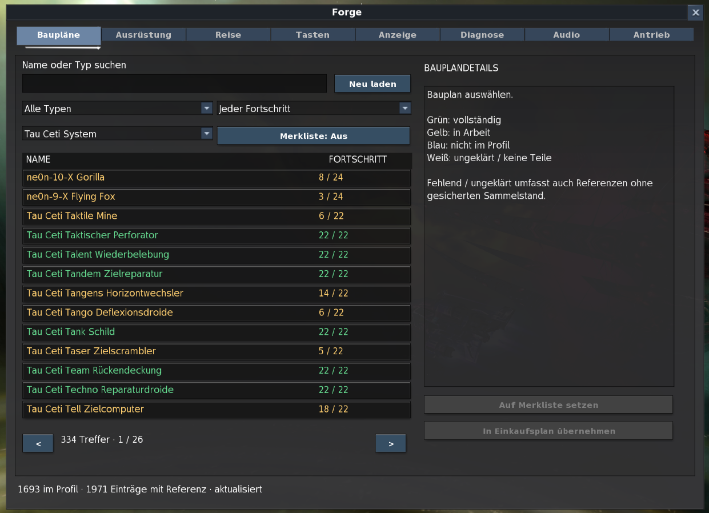
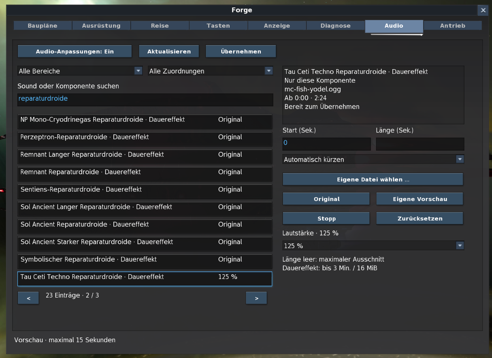
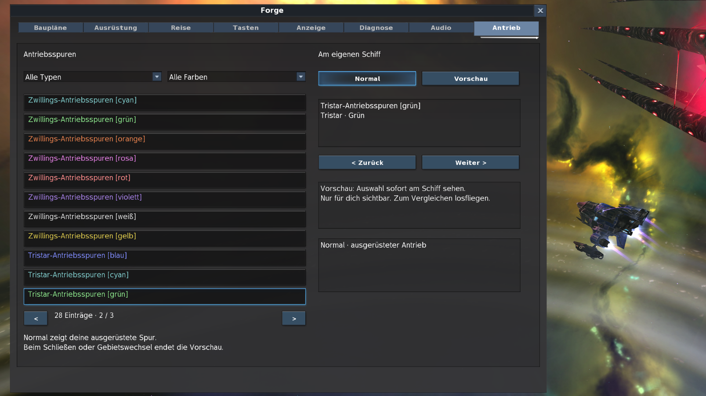
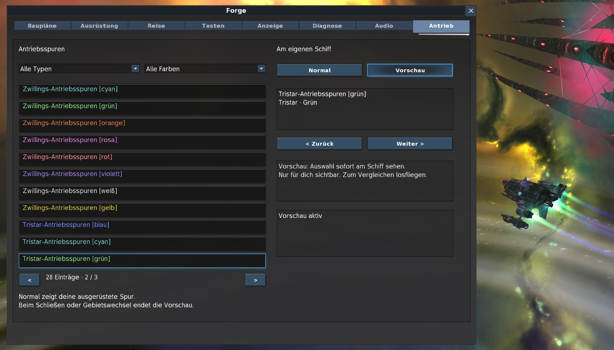
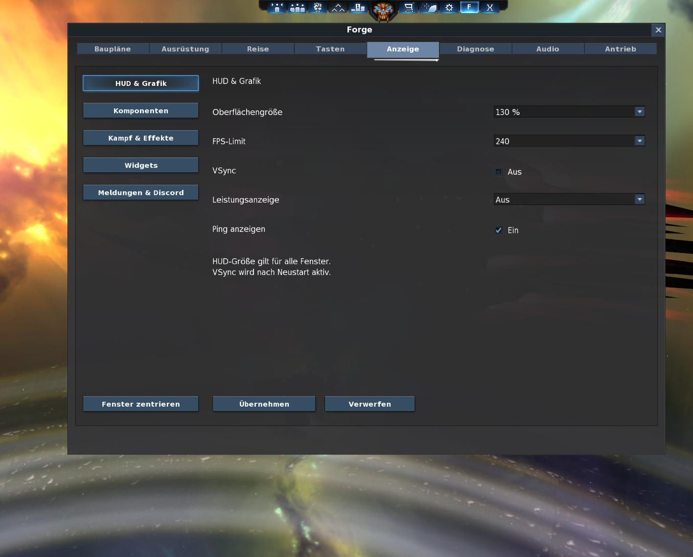
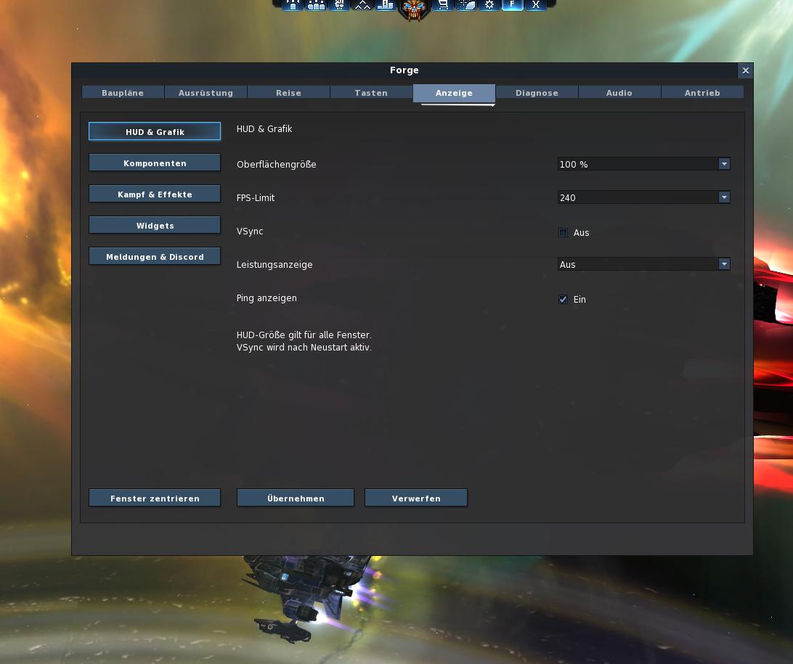
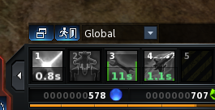

# Forge in Bildern

[Übersicht und Download](../README.md) · [Alle Funktionen](FUNKTIONEN.md) · [Hilfe](HILFE.md)

Spielaufnahmen aus Forge, bereitgestellt am **8. November 2026**. Alle Bilder lassen sich in Originalgröße öffnen. Die Aufnahmen zeigen Beispiele und lokale Einstellungen, keine 32-/64-Bit-Leistungsmessung.

[Bossleiste](#bossleiste) · [Remnant-Beute](#remnant-beute) · [Baupläne](#bauplaene) · [Audio](#audio) · [Antrieb](#antrieb) · [HUD](#hud) · [Slot-Timer](#slot-timer)

## Bossleiste und Effekte

Name, HP-Prozent und aktive Effekte direkt über dem Kampf. Die zusätzliche Bossleiste unterstützt Remnant-Träger und das Mutterschiff der Königin. Bekannte Laufzeiten stehen am Icon; weitere Effekte lassen sich über +N öffnen.

## Remnant-Beute und eigene Baupläne

Die Original-Trägertabelle bleibt erhalten. Forge ergänzt HP-Prozent und Beutekarten mit Icons und Beständen je Variante. „Nicht im Profil“ bedeutet, dass kein gesicherter Bestand vorliegt.

## Baupläne suchen und filtern

Im Beispiel ist Tau Ceti ausgewählt. Suche, Typ-/Fortschrittsfilter und Merkliste ergänzen das persönliche Bauplanprofil; die Teilezahlen bleiben direkt lesbar.

## Eigene Musik und Sounds

Ein Reparatur-Dauereffekt mit ausgewählter eigener Datei und 125 % Lautstärke. Ausschnitt, automatische Kürzung und Original-/Eigenvorschau stehen in derselben Ansicht. **Übernehmen** aktiviert die Änderung ohne Neustart; „Bereit zum Übernehmen“ kennzeichnet hier noch den Entwurf.

## Antriebsspuren direkt am Schiff vergleichen

**Normal:** Das Schiff zeigt seine tatsächlich ausgerüstete Spur, auch wenn in der Liste bereits eine andere Variante ausgewählt ist.

**Vorschau:** Die ausgewählten grünen Tristar-Spuren erscheinen lokal am eigenen Schiff. Die tatsächliche Ausrüstung und die Ansicht anderer Spieler bleiben erhalten.

## HUD-Größe und Anzeigeoptionen

Die globale Skalierung gilt für Forge und native Spielfenster. Im folgenden Beispiel sind **130 %** gewählt; oben ist auch der F-Knopf sichtbar. FPS-Limit, VSync, Leistungsanzeige und Ping liegen in derselben Einstellungsgruppe.

Zusätzliche Aufnahme mit 100 % anzeigen

Die beiden Aufnahmen haben unterschiedliche Bildausschnitte. Zum Prüfen der Textgröße jeweils das Originalbild öffnen; die Einpassung auf dieser Seite ist kein maßstabsgetreuer Direktvergleich.

## Aktivzeit und Abklingzeit im Slot

Die grünen Zahlen zeigen aktive Restzeiten, die weiße Zahl eine verbleibende Abklingzeit. Beide Zahlenanzeigen lassen sich getrennt schalten.

Weitere Funktionen wie Staffel-Effekte, Chat-Uhrzeit, Sirius-Zeitfenster und Kryonit-Drohnenwechsel sind in der [Funktionsübersicht](FUNKTIONEN.md) beschrieben.
